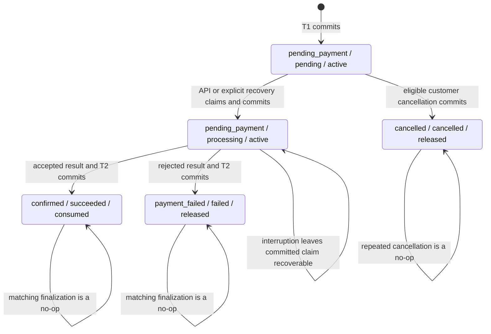
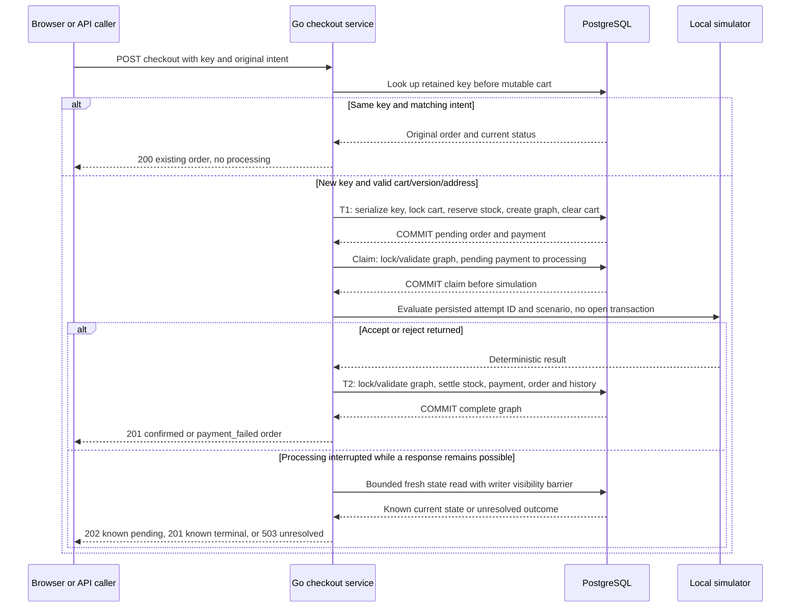

# Checkout Design — Project 1

M13 extends this transaction protocol to guest orders. The guest principal and original preparation supply the cart owner, shipping snapshot and payment scenario. Both owners share order creation, claim, settlement and reconciliation. Account requests retain their original hash format. [Guest commerce design](GUEST_COMMERCE_DESIGN.md) · [Implemented contract](../api/openapi.yaml)

**Status:** Implemented protocol; architecture/state review against current checkout/recovery code completed on 2026-10-20. No external provider or message broker. Consult [database schema](DATABASE_SCHEMA.md) for SQL and [OpenAPI](../api/openapi.yaml) for HTTP responses.

The accepted encoding, numeric limits, retry budgets, and recovery details are in `IMPLEMENTATION_DECISIONS.md`. T1 and T2 are business transactions; normal processing also commits a separate short claim transaction.

## Business guarantees

1. No committed checkout can reserve more than available inventory.
2. An accepted simulator result settles each reservation exactly once; a rejected result releases it exactly once.
3. Order/item prices and shipping address are server-derived immutable snapshots.
4. The same authenticated user and idempotency key map to one order forever within Project 1's retained data.
5. Concurrent use of different keys against the same cart version creates at most one order.
6. Rolled-back T1 leaves no order, reservations, or idempotency record. An uncertain COMMIT acknowledgement requires lookup with the same key; it does not prove rollback. Rolled-back T2 leaves a pending, fully recoverable order.
7. Reconciliation never guesses that a timed-out payment was rejected; Project 1 derives the immutable simulator outcome.

## State machines

| Order before | Trigger | Order after | Payment after | Reservation after | Stock operation |
|---|---|---|---|---|---|
| none | T1 commits | pending_payment | pending | active | increase reserved |
| pending_payment | processing claim commits | pending_payment | processing | active | none |
| pending_payment | T2 commits accepted result | confirmed | succeeded | consumed | decrease on-hand and reserved |
| pending_payment | T2 commits rejected result | payment_failed | failed | released | decrease reserved |
| pending_payment | eligible cancel before processing claim | cancelled | cancelled | released | decrease reserved |
| confirmed / payment_failed | matching duplicate finalize after graph validation | unchanged | unchanged | unchanged | none |
| cancelled | repeated cancellation after graph validation | unchanged | unchanged | unchanged | none |

Labels are **order / payment / reservation** statuses. A rolled-back transaction leaves its previous committed state. Recovery can claim `pending` or re-evaluate the existing `processing` attempt without a new attempt or backward transition; expiry alone changes no state. GET and same-key checkout retries only observe state. Terminal no-ops require a valid matching graph; cancellation after the claim and settlement of a cancelled order conflict.

Cancellation atomically stores `cancelled` on both order and payment and releases reservations; it is not a financial success/failure. The cancellation and processing claim compete under the same order lock.

Allowed payment transitions: `pending -> processing -> succeeded|failed`; `pending -> cancelled`. A recovery command may move persisted `processing` to its deterministic accepted/rejected terminal outcome. Transition from a terminal payment status is forbidden.

## Transaction sequence

This sequence shows valid checkout input and acknowledged commits. The simulator is an in-process call; its separate lane shows that SQL locks are released before simulation. Pre-T1 validation failures and uncertain commits follow the error policy below.

An eligible cancellation that wins before the claim yields a known cancelled order without simulation. Claim/T2 failures also use bounded fresh-state resolution; an integrity failure returns a safe 500 without repairing or erasing durable T1 data. A killed process can produce no response. For T1 COMMIT uncertainty, resolution serializes on the original key: a retained matching result returns 200 without processing; unresolved state returns 503. The client preserves the same key/body in either case.

Explicit recovery selects expired pending orders with SKIP LOCKED, validates the graph and commits any pending→processing claim before simulation. A persisted processing attempt is re-evaluated directly after releasing selection locks, then settled through the same guarded T2. This path is operator-invoked; browser polling never starts it. See [operator recovery instructions](RECOVERY.md).

## Checkout request and fingerprint

`POST /api/v1/checkout` requires bearer authentication and `Idempotency-Key` (1–128 visible ASCII characters, no whitespace, case-sensitive). Body: `cart_version` (positive integer within the JSON-safe bound), `shipping_address_id` (owned by customer), and `payment_scenario` (`accept` or `reject`). Test-only scenario selection is allowed in Project 1, explicitly disclosed in docs; do not use it in a real payment API.

Store one SHA-256 request-intent hash in `checkout_idempotency.request_hash`, atomically with its order ID in T1. Canonical input is compact UTF-8 JSON with fields in the fixed order `user_id`, `cart_id`, `cart_version`, `shipping_address_id`, `payment_scenario`; UUIDs are lowercase hyphenated strings, version is an integer, and there is no trailing newline. Store the lowercase hexadecimal digest. Resolved items, prices, and address values are persisted as order snapshots, without a second snapshot fingerprint column.

**Retry rule:** Lookup an existing key before reading the mutable cart or validating today's address/products. Obtain the original cart ID from the referenced order and compare the intent hash with the new version/address ID/scenario. Same-intent retries return the original order/current status without simulation; changed intent returns 409. Cart clearing and later address/product edits or address deletion do not invalidate the original intent.

The fingerprint policy above supersedes descriptions that incorrectly require rehashing the *current cart* on a retry.

## T1 — Create pending order and reserve (single pgx transaction)

0. Validate syntactic input, authenticated user and idempotency-key length. Reject invalid scenario/version.
1. Query for existing `(user_id, idempotency_key)` and compare intent hash if found; return referenced order without additional simulation. Serialize simultaneous first uses with a transaction advisory lock: hash `ecom:checkout:v1:<canonical-user-uuid>:<exact-key>` using SHA-256, interpret the first two four-byte words as big-endian signed int32 values, and use PostgreSQL's two-int transaction advisory lock. The full unique user/key constraint remains definitive; digest collisions only serialize unrelated requests.
2. Start T1 and acquire advisory lock; re-check key inside lock.
3. `SELECT ... FROM carts WHERE user_id=$1 FOR UPDATE`. Enforce requested cart version matches; cart must be nonempty. All cart modifications must lock this same row first; lock ordering is mandatory.
4. Read cart item rows and current active product prices; validate quantities and active state. Verify selected address belongs to customer; snapshot its canonical fields.
5. Sort distinct product IDs ascending. For each, conditionally update `inventory` to increment reserved only when sufficient available stock exists. If any fails, rollback T1. Ensure a cart version can only result in one order using the order unique index.
6. Calculate line totals and order total in integer cents with checked arithmetic.
7. Insert pending order, order items, active reservation records, payment attempt (`pending`, scenario), initial history row, idempotency record. The attempt's `simulator_reference` is a stable UUID/string derived from its ID; the outcome must not depend on call count.
8. Delete the cart items and increment `carts.version` while holding its lock. Commit.
9. After acknowledged commit, claim payment processing in its own short transaction, compute the simulator result without a transaction, and execute T2. If interrupted while a response can still be written, return 202 only when the committed pending order is known. Retries/polling observe its status; the explicit recovery CLI performs interrupted processing. A process crash may produce no HTTP response.

**Concurrency behavior:** Different idempotency keys for the same cart version serialize on its cart row; after the first commits, the second sees a new cart version and fails 409. If concurrent requests share the same idempotency key, the loser returns the order created by the winner. Lock acquisitions for finalization and recovery are order -> payment attempt -> reservations ordered by product UUID -> inventory ordered by product UUID.

## Deterministic synchronous payment simulator

The simulator reads the persisted `payment_attempts.scenario` and attempt identifier, never real customer/card data. An `accept` request deterministically maps to success and `reject` to failure. Fault injection (`interrupt_after_T1`, `interrupt_before_T2`, crash process) is controlled from test harness, not the customer API. Once a terminal outcome is stored, repeat invocations return it without mutating inventory.

Before performing simulator work, acquire an order lock, verify `pending_payment` and payment `pending`, and conditionally mark payment `processing` in a short transaction; commit this claim, then compute deterministic outcome outside the transaction. `processing` is an eligible state for safe recovery in Project 1 because no external side effect exists.

## T2 — Settle or release (single pgx transaction)

1. Begin transaction. Lock order; lock payment attempt; reject inconsistent terminal state or return no-op for matching terminal result.
2. Confirm order still pending and not cancelled. Require payment attempt `processing`; reconciliation must first claim a pending attempt in a separate short transaction.
3. Lock reservation rows in product UUID order; require each active. Conditional updates adjust inventory (success: on-hand and reserved down; failure: reserved down). Update every reservation status in this same transaction.
4. Set payment `succeeded` / `failed` and order `confirmed` / `payment_failed`; update timestamps and append `order_status_history` with prior/new status and reason. Commit.
5. On transient DB error rollback, leaving state recoverable. Never retry all of checkout with a *new* key automatically.

## Cancellation

`POST /api/v1/orders/{id}/cancel` is permitted only to the order's owner if order is `pending_payment` and payment attempt is `pending` (not `processing`). Under an order lock, atomically set attempt `cancelled`, order `cancelled`, release active reservations and append history. A second cancellation is idempotent in its resulting state; `confirmed` and `payment_failed` cancellation return conflict. Once payment processing was claimed, cancellation is unavailable until reconciliation finishes. No refunds in Project 1.

Cancellation has no request body. A lost COMMIT acknowledgement uses a bounded independent read with an order-row visibility barrier: known cancelled state returns 200; unresolved state returns 503 `order_outcome_uncertain`. Retry cancellation for the same order. This never promises rollback merely because a reply was lost.

## Expiration and recovery

Reservation deadline = order creation plus **15 minutes**. This is an operational reconciliation threshold, not a destructive timer. No always-on cron/worker in Project 1.

From the repository root: `go run ./backend/cmd/reconcile --dry-run --limit N` or `--apply --limit N`. Default dry-run; reject both mode flags together. Default limit 100, maximum 1,000. Capture one database cutoff and scan pending orders with deadlines at or before it, ordered by deadline then ID. Dry-run is read-only. Apply selects an order using `FOR UPDATE SKIP LOCKED`, locks/inspects its attempt, claims pending processing, and commits before simulation. Reacquire locks in T2; duplicate processing computation is safe, while settlement is guarded exactly once. Use a per-run cursor and count all visited candidates against the limit. Flag inconsistent terminal states for manual investigation and exit nonzero. There is no force-cancellation override. Emit structured audit logs and counters.

Never release a reservation just because the clock passed its deadline. A deterministic acceptance must lead to confirmation, even if recovered after expiry. Diagnostic reconciliation must verify `inventory.quantity_reserved` against sums of active reservation rows.

## Error/HTTP policy

| Condition | Response |
|---|---|
| Successful settled new order | `201` with order |
| New order committed but processing interrupted | `202` with pending order |
| Same key/same intent retry | `200` existing order |
| Same key/changed intent | `409` `idempotency_conflict` |
| Cart version stale or already checked out | `409` `stale_cart` |
| Insufficient stock | `409` `insufficient_inventory` |
| Cart empty | `422` `empty_cart` |
| Invalid or unauthorized address | `404` `address_not_found` (avoid existence disclosure) |
| Missing authentication | `401` |
| Invalid payload | `400` or `422` validation response |
| Unexpected DB failure before T1 commit | `500`, with no partial order |
| Unresolved T1 COMMIT acknowledgement | `503` `checkout_outcome_uncertain`; retry identical key/body |
| Unresolved claim/T2 COMMIT acknowledgement | `503` `checkout_outcome_uncertain`; retry identical key/body to observe status |
| Unresolved cancellation COMMIT acknowledgement | `503` `order_outcome_uncertain`; retry cancellation for the same order |
| Detected order/payment/reservation corruption | `500` safe internal error; no repair or successful terminal no-op |

The 500/no-partial-state guarantee requires a known rollback. A lost COMMIT acknowledgement may mean the order committed: inspect the retained key using a fresh connection, accounting for the original transaction still finishing. Return a known matching order if found; otherwise return 503 when certainty cannot be established, never assume absence proves rollback. Retry recognized SQLSTATE 40P01/40001 only, up to three total transaction attempts within the request budget, with the same identities. No automatic retry with a new key.

After T1, a bounded fresh read waits for unfinished order writers before returning a current known terminal (201) or pending (202) order. An integrity failure can return 500 after T1 committed; this does not erase that durable order. Same-key retries remain status-only 200 responses. An eligible cancellation racing the new checkout may produce a cancelled terminal order instead of a simulated outcome.

The exact wire schemas are in `../api/openapi.yaml`. Never expose stack traces or underlying SQL errors to clients.

## Project 7 boundary

No outbox, queue, SNS/SQS, Redis, background dispatch, distributed payment worker, or provider webhook in Project 1. Preserve clear interfaces around payment simulation and settlement so Project 7 can replace synchronous execution with durable asynchronous orchestration.
