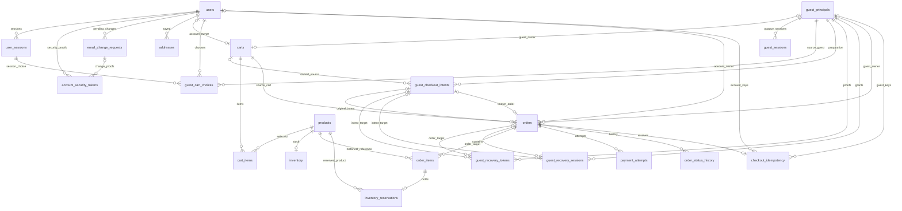

# Database Schema — Project 1

**Status** — Migrations 1–13 define **21 domain tables** and readiness **13**. Guest commerce adds constrained owners, immutable checkout snapshots and exact-target recovery credentials. [Checkout design](CHECKOUT_DESIGN.md) · [Account security design](ACCOUNT_SECURITY_DESIGN.md)

Accepted choices and bounds are recorded in [implementation decisions](IMPLEMENTATION_DECISIONS.md). Use `postgres:16-alpine` and Go 1.25.1. This source review does not assert the migration state of a running database; executed database checks belong in [status/evidence](PROJECT_STATUS.md).

## Conventions and invariants

Migration 12 gives carts exactly one account or guest owner and stores cart-choice receipts. Migration 13 extends that ownership to orders and keys. A guest order references the same guest, intent, cart and cart version. Recovery proofs and grants store SHA-256 verifiers and reference exactly one owned intent or order. The reference DDL below describes the account baseline. [Migration 12](../../backend/migrations/00012_guest_carts.sql) · [Migration 13](../../backend/migrations/00013_guest_checkout.sql)

- UUIDv4 generated in Go; `TIMESTAMPTZ` UTC instants; database timestamps default to `now()`; Go code updates `updated_at` explicitly.
- Money stored as nonnegative `BIGINT` cents, USD only. Validate upper bounds and checked multiplication/summation in Go; SQL constraints ensure nonnegative values.
- User email is trimmed and lowercased prior to storage and constrained to its canonical form. Email case-folding is an intentional simplification for the lab.
- Every order has >=1 item, enforced by the checkout service transaction and integration tests (not a row-level SQL CHECK).
- `quantity_on_hand >= quantity_reserved >= 0`. Reservation aggregation across rows must be maintained in short transactions; reconcile `inventory.quantity_reserved` against active reservation rows.
- Historical order totals, item snapshots, and shipping address cannot be edited through user endpoints. Restrict physical deletions of referenced entities.
- Uniqueness and CHECK constraints prevent invalid states but cannot alone enforce legal status transitions; use conditional updates in transactions.
- `users` deactivation and product retirement, not cascade deletion of order history.

## Entity relationships

Each edge represents a foreign key. `||` means exactly one parent, `o|` means zero or one and `o{` means zero or many. Owner and recovery-target constraints enforce exactly one of the corresponding nullable relationships. Goose tracks its metadata separately.



`inventory.product_id`, `carts.user_id`, `inventory_reservations.order_item_id` and `checkout_idempotency.order_id` are unique foreign keys. They limit child counts without requiring a child to exist. Registration/product creation atomically create their cart/inventory row; T1 creates at least one item, one reservation per item, one attempt, one key and initial history. Project 1 services require exactly one payment attempt per order; SQL permits multiple attempt numbers but at most one active attempt through a partial unique index.

`carts.guest_id` is unique. Guest bootstrap atomically creates the principal, session and cart. Runtime grants permit inserts and explicit state, counter and revocation updates. Owner columns and prepared request fields are immutable through those grants. The migrator can expire and scrub preparations, prune old proofs/grants and clean up unreferenced guest data in batches of at most 500 rows per mutation under a five-second client transaction deadline. Down migrations guard against data loss. [Maintenance SQL](../../backend/maintenance/guest_sessions.sql)

Order shipping is a JSON snapshot, not a foreign key to a saved address. Separate product/user foreign keys do not prove reservation/item agreement or common ownership across the checkout graph; services and reconciliation enforce those cross-row rules. `checkout_idempotency.status = 'completed'` means the order/key creation committed, even while payment remains pending.

## Reference PostgreSQL DDL

Table/index definitions below correspond to migrations 1–5 plus [credential version migration 10](../../backend/migrations/00010_credential_version.sql): [identity](../../backend/migrations/00001_identity.sql), [catalog/inventory](../../backend/migrations/00002_catalog_inventory.sql), [cart](../../backend/migrations/00003_cart.sql), [orders/reservations](../../backend/migrations/00004_orders_reservations.sql), and [payment/idempotency/history](../../backend/migrations/00005_payment_idempotency_history.sql). Apply files with goose; do not execute a second copy of this DDL. Migrations 6–9 add permissions, not domain tables. Destructive down migrations are for disposable databases only.

```sql
CREATE TABLE users (
 id uuid PRIMARY KEY, first_name text NOT NULL CHECK (length(trim(first_name))>0),
 last_name text NOT NULL CHECK (length(trim(last_name))>0),
 email text NOT NULL UNIQUE CHECK (email=lower(btrim(email)) AND length(email)>3),
 password_hash text NOT NULL, role text NOT NULL DEFAULT 'customer' CHECK (role IN ('customer','admin')),
 is_active boolean NOT NULL DEFAULT true,
 credential_version bigint NOT NULL DEFAULT 0 CHECK (credential_version >= 0),
 email_verified_at timestamptz,
 created_at timestamptz NOT NULL DEFAULT now(), updated_at timestamptz NOT NULL DEFAULT now()
);
CREATE TABLE user_sessions (
 id uuid PRIMARY KEY, user_id uuid NOT NULL REFERENCES users(id) ON DELETE CASCADE,
 refresh_token_hash text NOT NULL UNIQUE, expires_at timestamptz NOT NULL,
 revoked_at timestamptz, last_used_at timestamptz,
 created_at timestamptz NOT NULL DEFAULT now()
);
CREATE TABLE addresses (
 id uuid PRIMARY KEY, user_id uuid NOT NULL REFERENCES users(id) ON DELETE RESTRICT,
 label text, recipient_name text NOT NULL, line_1 text NOT NULL, line_2 text,
 city text NOT NULL, region text NOT NULL, postal_code text NOT NULL,
 country_code char(2) NOT NULL DEFAULT 'US' CHECK (country_code='US'),
 created_at timestamptz NOT NULL DEFAULT now(), updated_at timestamptz NOT NULL DEFAULT now()
);
CREATE TABLE products (
 id uuid PRIMARY KEY, sku text NOT NULL UNIQUE, name text NOT NULL,
 description text, image_url text,
 unit_price_cents bigint NOT NULL CHECK (unit_price_cents>=0),
 is_active boolean NOT NULL DEFAULT true,
 created_at timestamptz NOT NULL DEFAULT now(), updated_at timestamptz NOT NULL DEFAULT now()
);
CREATE TABLE inventory (
 product_id uuid PRIMARY KEY REFERENCES products(id) ON DELETE RESTRICT,
 quantity_on_hand integer NOT NULL DEFAULT 0 CHECK (quantity_on_hand>=0),
 quantity_reserved integer NOT NULL DEFAULT 0 CHECK (quantity_reserved>=0),
 updated_at timestamptz NOT NULL DEFAULT now(),
 CONSTRAINT inventory_within_stock CHECK (quantity_reserved<=quantity_on_hand)
);
CREATE TABLE carts (
 id uuid PRIMARY KEY, user_id uuid NOT NULL UNIQUE REFERENCES users(id) ON DELETE CASCADE,
 version bigint NOT NULL DEFAULT 1 CHECK (version>=1),
 created_at timestamptz NOT NULL DEFAULT now(), updated_at timestamptz NOT NULL DEFAULT now()
);
CREATE TABLE cart_items (
 id uuid PRIMARY KEY, cart_id uuid NOT NULL REFERENCES carts(id) ON DELETE CASCADE,
 product_id uuid NOT NULL REFERENCES products(id) ON DELETE RESTRICT,
 quantity integer NOT NULL CHECK (quantity>0),
 added_at timestamptz NOT NULL DEFAULT now(), updated_at timestamptz NOT NULL DEFAULT now(),
 UNIQUE (cart_id,product_id)
);
CREATE TABLE orders (
 id uuid PRIMARY KEY, user_id uuid NOT NULL REFERENCES users(id) ON DELETE RESTRICT,
 status text NOT NULL CHECK (status IN ('pending_payment','confirmed','payment_failed','cancelled')),
 subtotal_cents bigint NOT NULL CHECK (subtotal_cents>=0),
 total_cents bigint NOT NULL CHECK (total_cents>=0),
 currency char(3) NOT NULL DEFAULT 'USD' CHECK (currency='USD'),
 shipping_address jsonb NOT NULL CHECK (jsonb_typeof(shipping_address)='object'),
 source_cart_id uuid NOT NULL REFERENCES carts(id) ON DELETE RESTRICT,
 source_cart_version bigint NOT NULL CHECK (source_cart_version>=1),
 reservation_expires_at timestamptz NOT NULL,
 created_at timestamptz NOT NULL DEFAULT now(), updated_at timestamptz NOT NULL DEFAULT now(),
 UNIQUE (source_cart_id,source_cart_version),
 CONSTRAINT project1_totals CHECK (total_cents=subtotal_cents)
);
CREATE TABLE order_items (
 id uuid PRIMARY KEY, order_id uuid NOT NULL REFERENCES orders(id) ON DELETE RESTRICT,
 product_id uuid NOT NULL REFERENCES products(id) ON DELETE RESTRICT,
 sku_snapshot text NOT NULL, product_name_snapshot text NOT NULL,
 quantity integer NOT NULL CHECK (quantity>0),
 unit_price_cents bigint NOT NULL CHECK (unit_price_cents>=0),
 line_total_cents bigint NOT NULL CHECK (line_total_cents>=0),
 UNIQUE (order_id,product_id),
 CHECK (line_total_cents = quantity::bigint * unit_price_cents)
);
CREATE TABLE inventory_reservations (
 id uuid PRIMARY KEY,
 order_item_id uuid NOT NULL UNIQUE REFERENCES order_items(id) ON DELETE RESTRICT,
 product_id uuid NOT NULL REFERENCES products(id) ON DELETE RESTRICT,
 quantity integer NOT NULL CHECK (quantity>0),
 status text NOT NULL CHECK (status IN ('active','consumed','released')),
 expires_at timestamptz NOT NULL,
 created_at timestamptz NOT NULL DEFAULT now(), updated_at timestamptz NOT NULL DEFAULT now()
);
CREATE TABLE checkout_idempotency (
 id uuid PRIMARY KEY, user_id uuid NOT NULL REFERENCES users(id) ON DELETE RESTRICT,
 idempotency_key text NOT NULL CHECK (length(idempotency_key) BETWEEN 1 AND 128),
 request_hash text NOT NULL, -- SHA-256 of immutable request intent; see CHECKOUT_DESIGN.md

 order_id uuid NOT NULL UNIQUE REFERENCES orders(id) ON DELETE RESTRICT,
 status text NOT NULL DEFAULT 'completed' CHECK (status='completed'),
 created_at timestamptz NOT NULL DEFAULT now(),
 UNIQUE (user_id,idempotency_key)
);
CREATE TABLE payment_attempts (
 id uuid PRIMARY KEY, order_id uuid NOT NULL REFERENCES orders(id) ON DELETE RESTRICT,
 attempt_number integer NOT NULL CHECK (attempt_number>0),
 status text NOT NULL CHECK (status IN ('pending','processing','succeeded','failed','cancelled')),
 scenario text NOT NULL CHECK (scenario IN ('accept','reject')),
 simulator_reference text NOT NULL UNIQUE,
 failure_code text, started_at timestamptz, completed_at timestamptz,
 created_at timestamptz NOT NULL DEFAULT now(),
 UNIQUE (order_id,attempt_number)
);
CREATE TABLE order_status_history (
 id uuid PRIMARY KEY, order_id uuid NOT NULL REFERENCES orders(id) ON DELETE RESTRICT,
 previous_status text, new_status text NOT NULL,
 reason text, created_at timestamptz NOT NULL DEFAULT now(),
 CHECK (new_status IN ('pending_payment','confirmed','payment_failed','cancelled')),
 CHECK (previous_status IS NULL OR previous_status IN ('pending_payment','confirmed','payment_failed','cancelled'))
);
CREATE UNIQUE INDEX one_active_payment_attempt_per_order
 ON payment_attempts(order_id) WHERE status IN ('pending','processing');
CREATE INDEX orders_customer_recent ON orders(user_id,created_at DESC);
CREATE INDEX orders_pending_expiry ON orders(reservation_expires_at) WHERE status='pending_payment';
CREATE INDEX order_items_order ON order_items(order_id);
CREATE INDEX reservations_by_status_expiry ON inventory_reservations(status,expires_at);
CREATE INDEX reservations_product_active ON inventory_reservations(product_id) WHERE status='active';
CREATE INDEX history_order_time ON order_status_history(order_id,created_at);
CREATE INDEX sessions_user_expiry ON user_sessions(user_id,expires_at);
CREATE INDEX products_active_name ON products(is_active,name);
CREATE INDEX addresses_user ON addresses(user_id);
```

### Account-security storage — migration 11

[Migration 11](../../backend/migrations/00011_email_verification.sql) contains the exact DDL/indexes/grants for the additional tables. The preceding reference DDL covers the original thirteen tables plus added user columns.

| Table | Required data and constraints |
|---|---|
| `account_security_tokens` | UUID/user, unique 32-byte SHA-256 digest, purpose (`verify_email`, `reset_password`, `email_change_old`, `email_change_new`), canonical bound email, nonnegative credential version, creation/expiry, nullable consumed/invalidated timestamps. Expiry follows creation; consumed and invalidated are mutually exclusive. Only email-change purposes require a request; the composite request/user FK enforces common ownership. One active verification proof/user and one proof/purpose/request. |
| `email_change_requests` | UUID/user, distinct canonical old/new emails, credential version, creation/expiry, nullable old/new proof timestamps and finish timestamp. State is pending/completed/cancelled/expired/conflict; pending exactly when unfinished, completed requires both proofs, pending cannot have both. At most one pending request/user. Task 4 creates storage/status support; task 5 now implements the dual-proof issuance/confirmation/cancellation actions without a new migration. |

Security timestamps use `clock_timestamp()` and database expiry checks; digest-only proofs never appear in User/API DTOs. `users.email_verified_at` starts null for every existing/new account; the API exposes only required `email_verified: boolean`. Runtime may read/issue/invalidate/consume proofs and update verification state, but cannot delete security history or rewrite token bindings/creation/expiry. [Operator pruning](OPERATIONS.md#security-email-configuration-and-verification) uses bounded owner-only batches after retention.

## Relationship and deletion policies

- User → orders/addresses/checkout keys: `ON DELETE RESTRICT` preserves referenced rows. Public account deletion and anonymization workflows are not implemented; deactivation is an operator policy.
- User → sessions/carts and cart → cart items: `ON DELETE CASCADE` is defined for physical deletion, but referenced orders and other restricted links can prevent that deletion.
- Product → inventory/cart items/order items/reservations: `ON DELETE RESTRICT` prevents hard deletion while referenced; use `is_active` to retire.
- Order → items/payments/history/checkout key: `ON DELETE RESTRICT` preserves the checkout graph. Reservations reference order items with the same restriction; orders also restrict deletion of their source cart.
- Order item → reservation: SQL allows at most one reservation through its unique foreign key; T1 creates exactly one per item atomically, as required by Project 1.

## Indexes and uniqueness

These indexes and constraints are already defined in migrations 1–5 and the reference DDL above.

- Unique normalized `users.email` and unique `products.sku` prevent duplicate identities/catalog keys. Other single-column unique keys are shown in the DDL and relationship notes.
- Composite uniqueness covers cart/product, order/product, customer/idempotency key and order/attempt number. Unique `orders(source_cart_id, source_cart_version)` prevents duplicate checkout of a cart version.
- `orders_customer_recent` indexes `(user_id, created_at DESC)`; `orders_pending_expiry` indexes `reservation_expires_at` only where `status = 'pending_payment'`. The expiry index is partial, not a composite status/expiry index.
- `reservations_by_status_expiry` indexes `(status, expires_at)`; `reservations_product_active` indexes `product_id` only for active reservations.
- `one_active_payment_attempt_per_order` is a partial unique index on `order_id` where payment status is `pending` or `processing`.
- `order_items_order` and `history_order_time` support order-item and chronological history reads. `sessions_user_expiry`, `addresses_user` and `products_active_name` support session, address and catalog access.

Primary keys and unique constraints also create indexes. Future index changes need query-driven evidence; foreign keys do not automatically create indexes on their referencing columns.

## Application-enforced cross-row invariants

1. A checkout creates one order, at least one order item, one corresponding `active` reservation per item, one payment attempt, one idempotency row, and one initial history row **in the same transaction**.
2. Reservation product and quantity must equal those of the owning order item. Derive them from one trusted source and verify both in reconciliation. Every reservation expiry equals its order's deadline, derived from the same creation instant plus 15 minutes.
3. Every active reservation contributes exactly once to inventory `quantity_reserved`; a consumed reservation decreases **both** on-hand and reserved; released decreases reserved only.
4. Order `subtotal_cents` equals the sum of `order_items.line_total_cents`; check with transactional code and integrity tests.
5. `shipping_address` has the required canonical US keys and is immutable after creation; validate at the API/service boundary.
6. Order status, payment status and reservation transitions are guarded with conditional updates. Matching terminal finalization is a no-op only after graph validation; inconsistent graphs are refused, and settlement of a cancelled order conflicts.
7. There is one active cart per customer, but the cart persists after checkout. Its items are cleared and its version increments on checkout.
8. Account deletion does not physically remove order history. Enforce user ownership in all resource access.

## Transaction and access boundaries

The canonical [transaction sequence](CHECKOUT_DESIGN.md#transaction-sequence) separates T1, processing claim, simulation without a transaction, and T2. Writes use short READ COMMITTED transactions with consistent locks, conditional updates and bounded retries for recognized PostgreSQL aborts. Claim, settlement, cancellation and recovery validate/lock the order graph in the order: order → payment → reservations by product UUID → inventory by product UUID. T1 reserves inventory in product UUID order after locking the cart.

| Current handwritten queries | Responsibility |
|---|---|
| `auth.sql`, `accounts.sql` | Identity/session lifecycle, owned profiles and addresses |
| `products.sql`, `catalog.sql`, `cart.sql` | Active catalog reads, product/inventory management; parent cart locks and matching item/version reads |
| `checkout.sql` | Retained intent/advisory serialization, snapshots, guarded holds and atomic pending graph |
| `settlement.sql` | Graph locks, processing claims, guarded settlement/cancellation and order/payment reads |
| `recovery.sql` | One cutoff, ordered bounded candidates, SKIP LOCKED selection and global integrity diagnostics |
| `security.sql` | Owned pending-email status, ordered request/token locks, persistent issuance budget, conditional single-use proof consumption, invalidation and verified-email updates |

Sources live in [queries](../../backend/internal/db/queries); generated pgx code lives in [sqlc output](../../backend/internal/db/sqlc). Services own `pgx.Tx`; no repository abstraction is required per table. Recovery diagnostics use REPEATABLE READ READ ONLY snapshots, numeric diagnostic totals, exact finding counts and at most 100 examples; apply reuses settlement writes and permissions.

Runtime grants are defined by migrations [6](../../backend/migrations/00006_auth_permissions.sql), [7](../../backend/migrations/00007_core_api_permissions.sql), [8](../../backend/migrations/00008_checkout_permissions.sql), [9](../../backend/migrations/00009_settlement_permissions.sql) [10](../../backend/migrations/00010_credential_version.sql) and [11](../../backend/migrations/00011_email_verification.sql). Migration 10 permits credential-version updates; migration 11 permits email/verification changes and scoped security proof/request writes, while denying token binding/expiry rewrites and security-history deletion. They permit necessary column-scoped writes while denying role/activation changes, ownership reassignment, physical product deletion, immutable order/item data, attempt identity/scenario/reference, reservation quantity/links/deadline, and idempotency/history rewrites. Migration metadata writes remain denied. These restrictions protect the runtime role; a database owner can bypass them, so diagnostics still validate cross-row integrity.
