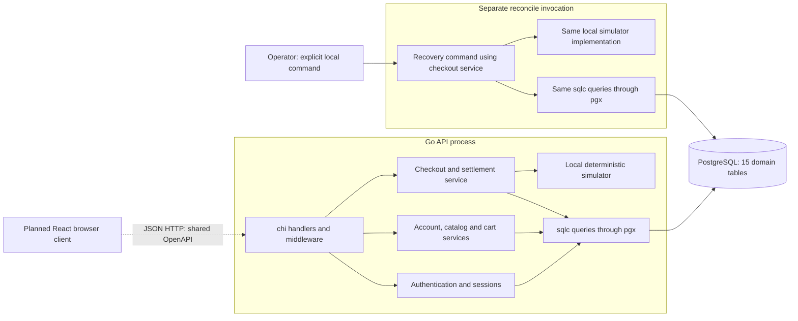

# Backend and Database Overview - Project 1

**Backend:** Go 1.25.1 + `go-chi/chi` + `pgx` + `sqlc` + `goose`
**Database:** PostgreSQL (`postgres:16-alpine`)
API 1.7.0 and schema/readiness 13 implement guest checkout, orders and exact-target recovery across 21 domain tables. Backend Milestones 1–5 retain their original acceptance record. [Guest commerce design](GUEST_COMMERCE_DESIGN.md) · [Project status](../PROJECT_STATUS.md) · [Baseline verification](evidence/MILESTONE_5_BACKEND_VERIFICATION.md)

M9 security work added password changes, SMTP delivery, explicit email verification/change and forgotten-password recovery under the [account-security design](ACCOUNT_SECURITY_DESIGN.md). Those accepted policies and schema-11 token storage remain unchanged by migration 12. Guest credentials are separate opaque cookies, never synthetic users or account authorization. [Task 4 evidence](../frontend/TEST_PLAN.md#milestone-13--guest-carts-and-admin-search) owns current native/browser checks and their limits.

Project 1 is a single Go application backed by PostgreSQL. Its reliability comes from transactions, immutable purchase snapshots, guarded state changes and explicit recovery. Go 1.25.1, chi, pgx, sqlc and goose are the current backend toolchain; local Compose runs `postgres:16-alpine` only.

## Project goal and boundaries

Build a small but credible e-commerce platform whose reliability comes from well-designed application logic and PostgreSQL transactions, not from adding many services. Customers register, browse products, maintain carts, submit checkout, and view durable orders. The system must prevent overselling, preserve historical purchase data, handle duplicate requests, simulate accepted/rejected payment outcomes, and recover when checkout is interrupted.

**Included:** customer identity and addresses; administrative product management; PostgreSQL-backed carts; order/item snapshots; reservation-aware inventory; T1/claim/T2 checkout; deterministic local payment simulator; checkout idempotency; explicit recovery CLI; PostgreSQL-only Compose environment; tests. Authenticated customer/admin browser journeys are accepted through M12; guest lifecycle and revised shopping presentation remain in the [M13 frontend scope](../frontend/OVERVIEW.md).

**Excluded:** real payments/card data, tax or shipping-rate computation, coupons, returns/refunds, complex fulfillment, multiple warehouses/currencies, Redis caches, SQS, pub/sub, event producers, outbox tables, distributed workers and DLQs. Those features require separate approved requirements; distributed payment reliability is reserved for Project 7.

## Application components

| Component | Responsibility | Trust/consistency boundary |
|---|---|---|
| React client | Catalog, cart, account, checkout, order history, status feedback; M13 guest lifecycle pending | Untrusted input; never authoritative for prices or stock |
| chi HTTP handlers | Parse/validate requests, authenticate/authorize, call services, map errors to HTTP | No business rules or transaction coordination in handlers |
| Go domain/application services | Checkout, inventory, cart, users, products, orders, simulator/recovery policies | Own business invariants and transaction boundaries |
| sqlc + pgx data access | Typed SQL queries, transaction-bound access | PostgreSQL enforces constraints and serializes conflicting updates |
| PostgreSQL | Authoritative customers, products, stock, carts, orders, payments, reservations | One transactional system of record |
| Deterministic payment simulator | Return repeatable accepted/rejected outcome for a persisted attempt ID and scenario | Local, synchronous, no external or financial side effects |
| Recovery command | Settle eligible interrupted orders and report integrity problems | Explicitly run, dry-run by default, guarded settlement; no automatic integrity repair |

## Logical domain model

- **Users** authenticate and own addresses, carts, and orders.
- **Products** describe catalog offerings and prices; **inventory** records stock/reservations independently.
- **Carts** are mutable collections of **cart items**. They are not orders and do not reserve inventory.
- **Orders** are durable checkout submissions containing one or more immutable **order items** and a delivery-address snapshot.
- **Inventory reservations** associate the quantity held with each order item and record whether the hold is active, consumed or released.
- **Payment attempts** record local simulation state and allow deterministic replay/reconciliation.
- **Checkout idempotency** ties a customer/request key to a single order and protects against retries.
- **Order status history** records transitions in the same transaction that changes order state.

## Runtime architecture

Solid connections describe implemented runtime paths; the dashed browser connection is planned. The simulator executes within the invoking Go process and performs no external payment operation. The recovery command is a separate invocation using the same database and service logic; the API does not start a recovery worker. Query/service boxes are code boundaries, not independently deployed services.

The [API entry point](../../backend/cmd/api/main.go) wires configuration, the pgx pool and handlers, starts HTTP serving, and handles graceful shutdown. The [recovery entry point](../../backend/cmd/reconcile/main.go) delegates to the command adapter. Neither entry point applies migrations. Local goose runs explicitly with migration credentials; API and recovery use the restricted runtime role.

## REST endpoint surface

These routes are implemented. Business routes use `/api/v1`; operational routes are at the server root. Public catalog reads return active products only. Public literal name/SKU search and administrator product list/detail/inventory reads are implemented. Cart presentation uses existing product reads without a cart contract extension; browser/fixture work remains in the [integration dispositions](../frontend/API_INTEGRATION.md#scope-gap-dispositions--milestone-51).

| Area | Method and route | Meaning |
|---|---|---|
| Auth | `POST /api/v1/auth/register`; `POST /api/v1/auth/login`; `POST /api/v1/auth/refresh`; `POST /api/v1/auth/logout` | Customer identity/session lifecycle |
| Profile | `GET /api/v1/users/me`; `PATCH /api/v1/users/me` | Read/update own account |
| Password | `POST /api/v1/users/me/password` | Bearer + Origin/CSRF + current-password proof; atomic password/version update and revocation of all sessions; no automatic replay/login |
| Addresses | `GET /api/v1/users/me/addresses`; `POST /api/v1/users/me/addresses`; `PATCH /api/v1/users/me/addresses/{id}`; `DELETE /api/v1/users/me/addresses/{id}` | Manage own saved addresses |
| Catalog | `GET /api/v1/products`, `GET /api/v1/products/{id}` | Browse/search active catalog with literal q and filtered pagination |
| Admin | `GET /api/v1/admin/products`; `GET /api/v1/admin/products/{id}`; `POST /api/v1/admin/products`; `PATCH /api/v1/admin/products/{id}`; `DELETE /api/v1/admin/products/{id}` | Administrator-only active/retired reads, creation, updates and retirement |
| Inventory admin | `GET /api/v1/admin/products/{id}/inventory`; `PATCH /api/v1/admin/products/{id}/inventory` | Coherent read-only counters and controlled stock adjustment |
| Cart | `GET /api/v1/cart`; `POST /api/v1/cart/items`; `PATCH /api/v1/cart/items/{id}`; `DELETE /api/v1/cart/items/{id}`; `DELETE /api/v1/cart/items` | Read own cart, add/update/remove items or clear it |
| Checkout | `POST /api/v1/checkout` | Create pending order, claim processing and simulate/settle; replay observes existing status |
| Orders | `GET /api/v1/orders`, `GET /api/v1/orders/{id}` | Customer's order history/details |
| Cancellation | `POST /api/v1/orders/{id}/cancel` | Conditional business action, not arbitrary status edit |
| Payment status | `GET /api/v1/orders/{id}/payments` | Safe payment attempt statuses |
| Ops | `GET /health/live`, `GET /health/ready`, `GET /metrics` | Public liveness/readiness; authenticated administrator metrics |

Precise request/response schemas, authentication rules, error payloads, pagination and HTTP semantics belong in [OpenAPI](../api/openapi.yaml). Except for public registration/catalog and cookie-based session operations, business routes require bearer authentication; administrator writes also require the current admin role. No customer endpoint allows directly creating arbitrary order items or setting internal payment/order statuses.

## Browser and operator boundaries

| Boundary | Current responsibility |
|---|---|
| Browser → HTTP | Untrusted input. The server validates payloads and enforces current account/session state, roles and resource ownership. Browser prices, totals and stock are never authoritative. |
| HTTP → services | Handlers decode requests and map results/errors; services own transaction coordination. Middleware adds request IDs, safe logs, panic recovery, body bounds, origin policy and authentication where required. Server/service deadlines bound work. |
| Sessions | Argon2id password hashes, short-lived bearer JWTs and rotating refresh verifiers. Refresh cookies are HttpOnly, SameSite=Strict and Secure in production; login/refresh/logout require the configured Origin and CSRF header. Protected requests check current database session/account state. |
| Services → PostgreSQL | Typed SQL and service-managed pgx transactions enforce stock holds, cart versions, snapshots, idempotency and legal state changes. Database constraints and column-scoped runtime grants provide additional protection. |
| Operator → recovery | Explicit dry-run by default; bounded apply can claim/resume eligible interrupted attempts. Global diagnostics report inconsistencies without repairing them. See the [recovery guide](RECOVERY.md). |
| Operational HTTP | `/health/live` checks process responsiveness; `/health/ready` checks database connectivity and schema version 11. `/metrics` requires an authenticated administrator and reports an in-process authentication counter. |

Browser session coordination, page design and API extensions remain in the [frontend integration plan](../frontend/API_INTEGRATION.md). The current API serves no frontend assets. Final packaging is a later [project release milestone](../IMPLEMENTATION_SEQUENCE.md#final-release-gates--milestone-14).

## Consistency guarantees

- Users own sessions, saved addresses, a persistent cart and orders. Registration creates the customer and cart atomically; customers cannot grant themselves administrator privileges.
- Products carry current catalog data; inventory stores on-hand and reserved quantities with `on_hand >= reserved >= 0`. A cart stores intended quantities and a version; adding an item does not reserve stock.
- Checkout creates durable order/item prices and shipping snapshots. Later catalog/address edits do not rewrite a purchase. Money uses bounded integer USD cents; addresses are US-only.
- Reservations link each order item to its stock hold. The service maintains their product/quantity/deadline agreement and the aggregate reserved counter transactionally.
- Customer-scoped idempotency keys retain one order and its original intent. A second key cannot create another order from the same cart version. Retries observe the retained result without starting payment processing again.
- T1 creates the pending graph and consumes the cart; a separate committed claim precedes simulation outside a transaction; T2 settles the graph atomically. Cancellation is allowed only before the processing claim.
- Expiry marks recovery eligibility after 15 minutes. It does not authorize releasing stock without deriving the persisted deterministic outcome. Lost COMMIT acknowledgements require bounded resolution; they do not prove rollback.

The [physical ER diagram and schema](DATABASE_SCHEMA.md#entity-relationships) distinguish database constraints from service-enforced cross-row guarantees. The canonical [checkout transaction sequence](CHECKOUT_DESIGN.md#transaction-sequence) and [combined state diagram](CHECKOUT_DESIGN.md#state-machines) show payment, reservation and recovery behavior without duplicating their protocol here.

## Implementation policies

This summary retains the accepted backend choices. [Implementation decisions](IMPLEMENTATION_DECISIONS.md) owns their detailed rationale and bounds; [checkout design](CHECKOUT_DESIGN.md) owns the transaction protocol.

- **Versions:** Retain Go 1.25.1 and `postgres:16-alpine` per owner instruction. Record PostgreSQL's resolved digest/server version in evidence; the selected tag can move between runs. See `IMPLEMENTATION_DECISIONS.md` for dependency/tooling policy.
- **Identifiers and money:** Go-generated UUIDv4 primary keys; USD and signed BIGINT cents, with validated bounds and overflow checks.
- **Accounts:** Store normalized trimmed/lowercased email for this lab's matching policy. Registration always creates the `customer` role. Refresh tokens are stored as verifiers, rotated atomically, and revoked on logout.
- **Addresses:** US-only, validated required fields; orders capture an immutable shipping-address snapshot. Product imagery is an optional URL only.
- **Checkout concurrency:** Lock the cart before reading its contents; every cart mutation locks it and increments its version. Inventory rows are reserved in ascending product UUID order. Duplicate requests are serialized by customer-scoped idempotency key and uniqueness of `(source_cart_id, source_cart_version)`.
- **Idempotency:** `Idempotency-Key` is required. Store SHA-256 of canonical customer/cart ID/version/address ID/scenario intent, not mutable cart contents or address values. Order snapshots preserve resolved contents. Same-intent retries return the existing order/status without simulation; changed intent returns 409. Keys are retained for the life of the order.
- **Checkout:** T1 creates pending order/items/reservations/attempt/history/idempotency and clears the cart. A separate short transaction claims processing. Simulation executes without an open transaction. T2 atomically finalizes payment/order/inventory/history. An uncertain COMMIT acknowledgement requires lookup/retry with the same key, never an assumption of rollback.
- **Simulator:** Deterministic `accept` or `reject` scenario persisted in the payment attempt; there is no external payment processor. An `interrupt` fault mode is strictly a test harness control and never a third financial result. A failed or interrupted response remains recoverable using the same payment attempt and scenario.
- **Statuses:** Orders: `pending_payment`, `confirmed`, `payment_failed`, `cancelled`. Payments: `pending`, `processing`, `succeeded`, `failed`, `cancelled`. No `payment_unknown` order status in Project 1. An unfinished attempt is pending/processing and is reconciled safely.
- **Reservation expiry:** Initial policy 15 minutes. Expiry flags an order for review, not unconditional cancellation. The explicit recovery command must first derive and apply the persisted deterministic simulator result when a payment attempt exists.
- **Cancellation:** Customer cancellation requires order `pending_payment` and payment `pending`, before processing is claimed; it atomically cancels both and releases reservations. No refunds or confirmed-order cancellation in Project 1.
- **Historical transitions:** A transition history row is written transactionally with every order status change. At most one active payment attempt (`pending` or `processing`) per order, enforced with a partial unique index.

## Source and documentation ownership

| Source | Responsibility |
|---|---|
| `backend/cmd/api`, `backend/cmd/reconcile` | Process entry points |
| `backend/internal/auth`, `commerce`, `checkout` | HTTP adapters, application rules and transaction orchestration |
| `backend/internal/reconcilecmd` | Recovery flags, configuration and JSONL output |
| `backend/internal/platform` | Configuration, database readiness, HTTP server and shared request handling |
| `backend/internal/db/queries`, `backend/internal/db/sqlc` | Handwritten SQL and generated pgx code |
| `backend/migrations`, root `sqlc.yaml` | Ordered goose migrations and query generation configuration |
| Root `compose.yaml`, `infrastructure/postgres/init.sh`, `scripts` | PostgreSQL environment/bootstrap and local development tooling |

Use [OpenAPI](../api/openapi.yaml) for exact routes/wire schemas, [engineering decisions](IMPLEMENTATION_DECISIONS.md) for choices/bounds, and the [test plan](TEST_PLAN.md) for verification requirements. Executed results live in [status](PROJECT_STATUS.md) and [dated evidence](evidence/README.md). The [backend sequence](IMPLEMENTATION_SEQUENCE.md) summarizes milestone scope/progress; detailed frontend requirements remain in the [frontend documents](../frontend/OVERVIEW.md).

Real payment providers, outbox/queues, Redis, distributed workers and other Project 7 components remain outside Project 1. The [project overview](../OVERVIEW.md) owns the complete scope and release boundaries.
