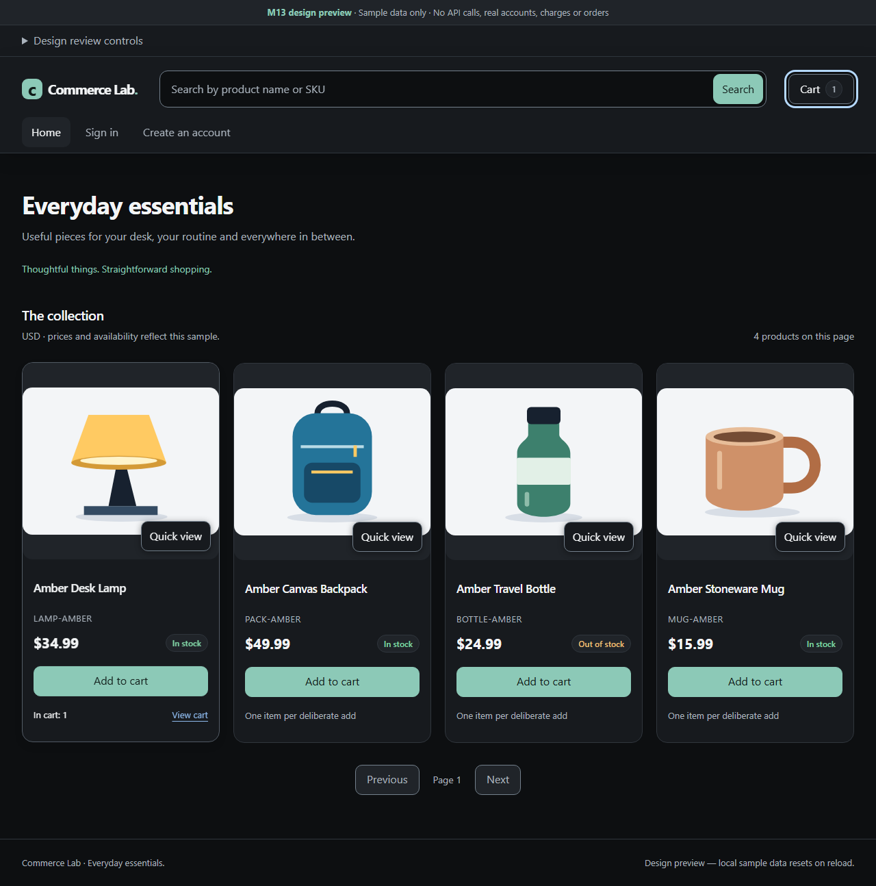
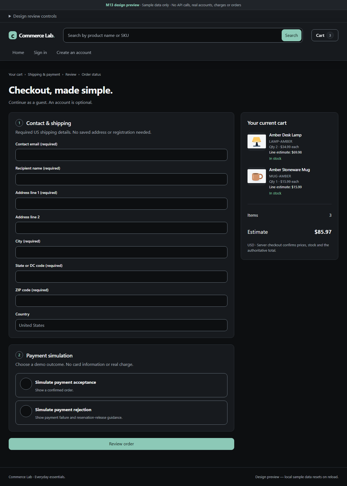

# Frontend

A React single-page app for the storefront, account, guest checkout and admin screens. It has no state, HTTP or form library. The hard part is making sure the browser never turns an uncertain write into a duplicate order or a wrong message, across tabs, reloads and identity changes.

| Document | What it covers |
|---|---|
| [ARCHITECTURE.md](ARCHITECTURE.md) | Stack, layout, the session model and cross-tab coordination |
| [API_INTEGRATION.md](API_INTEGRATION.md) | Credentials per call, retry policy, timeouts, and the full operation inventory (checked by a test) |
| [CHECKOUT_RECOVERY.md](CHECKOUT_RECOVERY.md) | How checkout survives double clicks, lost replies, reloads and crashes |
| [UI_DESIGN.md](UI_DESIGN.md) | Visual system, page design, interaction states, accessibility |
| [TESTING.md](TESTING.md) | Unit and browser suites, and the per-test isolated backend harness |
| [FIXTURES.md](FIXTURES.md) | Reproducible demo data in disposable databases |

| Catalog (desktop) | Guest checkout |
|---|---|
|  |  |

The screenshots come from the design preview, which uses synthetic data.
