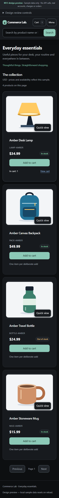
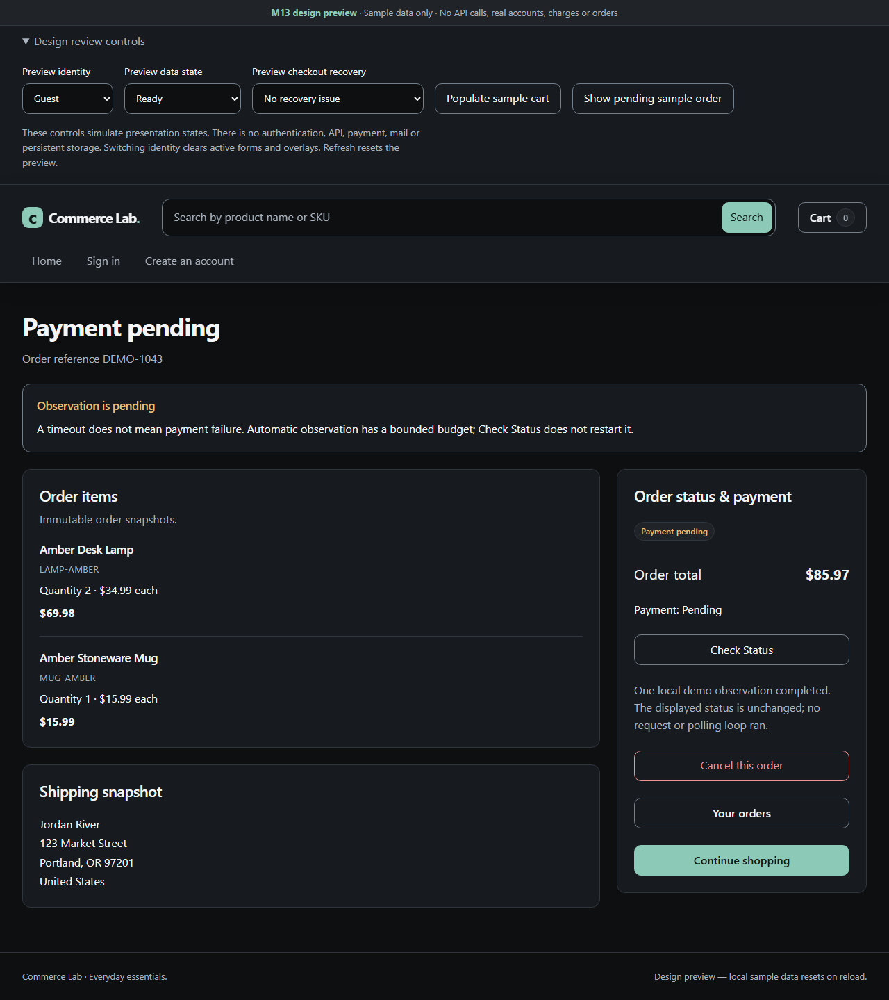

# UI design

A dark storefront in charcoal and near-black, with a soft mint accent. **Rule of precedence:** when a visual requirement conflicts with a security or reliability rule, the rule wins. For example, an uncertain write always gets a persistent warning, never a toast that disappears.

| Catalog (mobile) | Pending order |
|---|---|
|  |  |

These screenshots come from the Milestone 13 design preview, with synthetic data.

## Design choices

| Choice | Why | Trade-off accepted |
|---|---|---|
| **Explicit payment simulation** (accept or reject, chosen by the shopper), then **Review order**, then a separate **Place order** | Both settlement paths can be demonstrated, and the final action is always deliberate | One extra step compared with a one-click checkout |
| **Sign-in never merges carts**: the shopper picks *keep account cart* or *use guest cart* | No silent quantity changes | One extra decision |
| **Current cart only at checkout**, with recovery notices only when they are relevant | Earlier orders don't clutter the purchase | Order history lives on its own page |
| **Unknown prices are never shown as zero**; the subtotal is an estimate until the server confirms it | Never shows a number the server would contradict | Unpriced lines block the subtotal |
| **The mini-cart is a fixed rail only at ≥ 1920 px**, and a sheet below that | The 4-column product grid never reflows when the cart opens | Two mini-cart layouts |
| **Literal search and Previous/Next paging, no totals** | Matches the API: no count queries, no ranking service | No "page 3 of 12" |
| **System fonts, no remote assets** | No third-party requests and no font licensing | Less typographic character |
| **Project-owned shadcn components** (copied in and reviewed), next to native elements where those already behave correctly | Accessible primitives without a component-library dependency | We maintain the copies |

## Visual system

Colour tokens live in `src/styles.css` and are mapped into Tailwind.

| Token | Colour | Use |
|---|---|---|
| `background` / `surface` / `surface-elevated` | `#0D0F11` / `#171A1E` / `#202429` | Page, cards, menus |
| `primary` (hover / pressed) | `#8CC9B7` (`#A5D9C8` / `#6EB09C`) | Primary actions, selection |
| `foreground` / `muted-foreground` | `#F3F5F6` / `#AAB3BD` | Text |
| `focus` | `#B5D9FF` | Keyboard focus ring |
| `success` / `warning` / `destructive` | `#80D4A5` / `#E5BF78` / `#ED9393` | Status |

Text contrast is at least 4.5:1, and controls and focus at least 3:1. Targets are at least 44 px. Motion is limited to 150–200 ms colour and elevation changes, and `prefers-reduced-motion` is respected.

## Interaction states

| State | Behaviour |
|---|---|
| Loading | Labelled progress with a stable layout; never a misleading zero badge |
| Empty or not found | Context and a next step; visibly different from a failed request |
| Input error | Input is kept, the error summary is focused, and each error links to its field |
| Uncertain write | Persistent warning, further edits blocked, and an explicit recheck action |
| Success | Announced with `role=status`, without stealing focus |

## Accessibility

Semantic landmarks, one `h1` per page, a skip link, visible labels, and keyboard operation everywhere. A route change updates the title and moves focus to the heading. Back and forward keep the query and the scroll position.

**Verified:** 348 Chromium browser tests, including sampled keyboard, reflow and contrast checks, plus visual reviews at 5 widths. **Not certified:** real zoom, screen readers, password managers, other browser engines and physical devices.

## Design process

In Milestone 13 the layouts were reviewed in a separate React preview with synthetic data before the production pages were built. The preview was removed once the app implemented them; it remains in the repository history.
